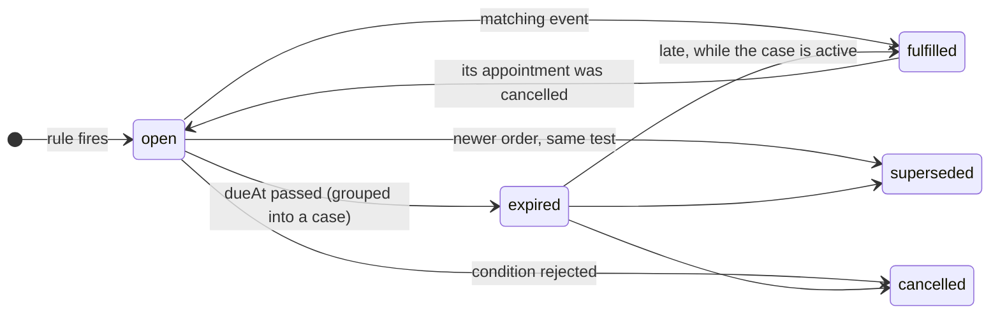
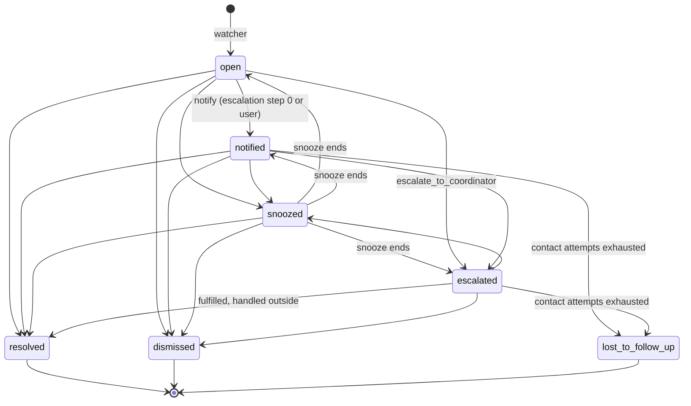

# @follow-up-engine/core

Pure domain, ports and the follow-up engine. No I/O: every effect goes through a port (`packages/core/src/ports`) implemented by an adapter (`adapter-memory`, `adapter-postgres`, `llm`). Design principle: **rules first, AI second, human last**.

```
src/
  domain/        ids, clinical events, expectations, cases, conditions, findings, domain events, errors
  config/        zod schemas of rules, protocols and escalation policies + pure JSON loaders
  ports/         repositories, UnitOfWork, JobQueue/Outbox, Clock, IdGenerator, NoteExtractor,
                 ClinicDirectory, LlmGateway, LlmUsageLog, RuleSource, ProtocolSource,
                 EscalationPolicySource, ContactRepository, SuppressionRepository
  engine/
    application/ createFollowUpEngine, ingest, note extraction job, condition commands
    annotator/   the four expectation layers + condition inference + the annotation pipeline
    matching/    declarative filters, match keys, fulfillment and supersession
    watcher/     deadline sweep: expire expectations, open or merge cases
    case-manager/ case state machine, writer (audit + outbox), priority, reconciliation, commands
    escalation/  escalation sweep and scheduling
    patient-contact/ who may be contacted, and when; contact attempts and their outcomes
    suppression/ rules stopped for one patient ("not applicable")
    calibration/ per-rule usefulness and dismissal reasons
    reviewer/    the clinical reviewer (V3): dossier, trends, detectors, read-only agent tools,
                 citation checks, coverage, flags, the review service (docs/reviewer.md)
```

## Entry points

```ts
const engine = createFollowUpEngine({
  unitOfWork, // UnitOfWork: every write of an operation commits together (jobs and outbox included)
  noteExtractor, // NoteExtractor: reads the doctor's plan from a note (llm package, or FakeNoteExtractor)
  rules, // RuleSource: config/rules enabled for the clinic
  protocols, // ProtocolSource: config/protocols enabled for the clinic
  clinics, // ClinicDirectory: clinic settings (allowPatientContact, escalationPolicyId, ...)
  escalationPolicies, // optional EscalationPolicySource: named, versioned policies (default_v1, default_v2)
  clock, // Clock: SystemClock or FakeClock
  ids, // IdGenerator: UUIDs in production, a sequence in tests
  settings, // optional Partial<EngineSettings>
});
```

| Method                                                                        | What it does                                                                                                                                                                                                                                                                                                                                           |
| ----------------------------------------------------------------------------- | ------------------------------------------------------------------------------------------------------------------------------------------------------------------------------------------------------------------------------------------------------------------------------------------------------------------------------------------------------ |
| `ingest(batch: ClinicalBatch): Promise<IngestReport>`                         | "A consultation was saved". Reads the notes (outside the transaction), then in one transaction: stores the events, derives conditions, creates expectations (universal → doctor's plan), applies fulfillment and supersession, adds cadence and lets protocols fill the gaps, resolves satisfied cases, records quality findings. Idempotent.          |
| `runWatcher(clinicId, now): Promise<WatcherReport>`                           | Releases the backfill cases whose day came (`casesReleased`), then the deadline sweep: open expectations with `dueAt <= now` become `expired` and are grouped into one active case per patient and case group (opened or merged).                                                                                                                      |
| `runEscalation(clinicId, now): Promise<EscalationReport>`                     | Advances every due case along its escalation policy; wakes snoozed cases. Emits `case.escalated`, `patient_contact.requested`, `case.resolved` to the outbox.                                                                                                                                                                                          |
| `runNoteExtractionJob(clinicId, payload): Promise<IngestReport>`              | Handler of the `note.extract_plan` job enqueued when the extractor failed during ingest. Throws to be retried.                                                                                                                                                                                                                                         |
| `cases.apply(clinicId, caseId, action, actor)`                                | `notify`, `snooze`, `resolve`, `dismiss`, `assign` (also as `cases.notify`, `cases.snooze`, ...). Invalid transitions throw `InvalidCaseTransitionError` (HTTP 409).                                                                                                                                                                                   |
| `cases.dismiss(clinicId, caseId, actor, { reason, note?, suppressRuleIds? })` | "Descartar": a reason is mandatory (`DismissReason`; `other` needs a note), recorded as the case's feedback too (not useful, same reason and note). With `not_applicable_to_patient`, `suppressRuleIds` stops those rules of the case for the patient (protocol items and the visit pattern only). `ValidationError` (HTTP 422).                       |
| `cases.requestPatientContact(clinicId, caseId, actor)`                        | A user asks the host to contact the patient ("Pedir contacto"): opens a contact attempt (`CommunicationRequest`, no channel: the host chooses), audits `patient_contact_requested`, emits `patient_contact.requested`. Throws `PatientContactNotAllowedError` (`reason`: `clinic_disallows_contact`, `patient_opted_out`, `contact_window`; HTTP 409). |
| `cases.recordCallOutcome(clinicId, caseId, { outcome }, actor)`               | The team called the patient ("Llamar al paciente"): the outcome is recorded as a `Communication` (medium phone, sender the user) on the case's call and the engine reacts as to any outcome; `contact.outcome_recorded` goes to the host.                                                                                                              |
| `cases.recordFeedback(clinicId, caseId, input)`                               | Useful / not useful; a reason is mandatory when not useful (`ValidationError`, HTTP 422).                                                                                                                                                                                                                                                              |
| `contacts.recordCommunication(clinicId, input)`                               | What came of an attempt (an inbound FHIR `Communication`): stored at its latest version, then the engine reacts (see [Patient-contact loop](#patient-contact-loop)). Idempotent; an older version is ignored; `NotFoundError` for an attempt of another clinic.                                                                                        |
| `contacts.forPatient / getRequest / getCommunication / contactDataUpdated`    | The patient's attempts, outcomes and contact data flags; the host corrected the contact data (clears the flags).                                                                                                                                                                                                                                       |
| `suppressions.suppress / reactivate / list`                                   | Rules stopped for one patient; "Volver a activar" reopens what the suppression withdrew (unless the record fulfilled it meanwhile) and lets the protocols fill the gaps again.                                                                                                                                                                         |
| `calibration(clinicId, { since? })`                                           | Per rule: cases with a verdict, useful rate (the latest verdict per case), dismissals by reason, not-useful reasons.                                                                                                                                                                                                                                   |
| `conditions.confirm / reject(clinicId, patientId, code, userId)`              | Clinician review of an inferred or extracted condition. Rejecting cancels the protocol expectations that relied on it.                                                                                                                                                                                                                                 |
| `catalog(clinicId)`                                                           | The enabled rules and protocols as `ExpectationDefinition`s (labels, suggested actions, policies).                                                                                                                                                                                                                                                     |
| `patientContactStatus(clinicId, patientId)`                                   | Whether the engine may contact the patient, when it last asked for a message, and whether the contact data is flagged.                                                                                                                                                                                                                                 |
| `backfill.stage / run / status / schedule / release`                          | The initial backfill of a clinic; see [Initial backfill](#initial-backfill).                                                                                                                                                                                                                                                                           |

## Expectation layers

| Layer         | Source                                                                                                                                        | Example rule ids                                                                                                                                                                                                                                                                |
| ------------- | --------------------------------------------------------------------------------------------------------------------------------------------- | ------------------------------------------------------------------------------------------------------------------------------------------------------------------------------------------------------------------------------------------------------------------------------- |
| `universal`   | Structured data only, no LLM; clinical criteria in config (short treatment, result targets).                                                  | `lab_order_result_pending` (15 d), `imaging_order_result_pending` (30 d), `short_treatment_followup` (end of treatment + 3 d), `abnormal_result_followup` (7 d)                                                                                                                 |
| `doctor_plan` | Plan items the `NoteExtractor` read from the note ("control en 3 meses"). The item's own date wins.                                           | `doctor_plan_followup`                                                                                                                                                                                                                                                          |
| `cadence`     | A break in the patient's own visit pattern: with 2+ previous visits of the same specialty, the next one is due within 3x the median interval. | `cadence_break`                                                                                                                                                                                                                                                                 |
| `protocol`    | Per-condition guideline for enrolled patients (confirmed or probable condition).                                                              | `protocol_diabetes_hba1c`, `protocol_pregnancy_prenatal_visit`, `protocol_treatment_followup_visit`, `protocol_hypothyroidism_tsh`, `protocol_dyslipidemia_lipids`, `protocol_chronic_kidney_disease_renal_function` (every item: [docs/protocols.md](../../docs/protocols.md)) |

Precedence:

1. **The doctor's plan beats the protocol and the cadence.** Protocols run last and skip any item already asked for by a live `doctor_plan` or `universal` expectation with the same match key (`visit`, `loinc:4548-4`, ...), a code of the item's equivalence group (the codes its `fulfilledBy` filters accept: any lipid panel LOINC) or, for an uncoded plan item, a quote that names the test (`planTerms`: "control en 3 meses con HbA1c"). An order or plan item that arrives later withdraws a live protocol expectation the same way (`cancelled`, `covered_by_later_request`). The cadence layer skips the next visit while a live `doctor_plan` visit or session asks for it (checked after fulfillment, so the visit that fulfills the plan brings the pattern back).
2. **The doctor's plan also beats a generic universal control** (`coveredByPlan`): a short-treatment or abnormal-result control is not added when a plan visit is already due by then ("control en 10 días" after a 7-day antibiotic is one reason, not two).
3. **Cadence needs a pattern**: at least 2 previous visits of the specialty, i.e. one interval (intervals under 7 days ignored); a single visit never makes one. **Closed episodes are not a pattern**: everything up to a discharge ("se da de alta"), a pregnancy once its postpartum visit came (`episodes`: diagnoses `O`, `Z33`-`Z36`, closed by `Z39`), an acute episode and its control (a visit that started a short course and the next visit within the course + 14 days), and the control a single visit's plan asked for when that control plans nothing further (`plannedControl`: a sprain and its control, "control en 14 días" and the control; three or more visits chained by their plans are a routine pattern and stay). A discharge read later (separate note, retried extraction) withdraws the cadence expectation it anchored (`patient_discharged`).
4. **One case per patient and reason group.** Expectations whose rules share a `caseGroup` (`follow_up`, `pending_results`) merge into one case with all their reasons.
5. **A note without a plan is a quality finding** (`note_without_plan`), never a case. So is a note too long to be read whole (`note_truncated`, the extractor's `truncated`): the plan read from its head and tail may be incomplete.

Clinical criteria of the universal rules (config, see `config/rules/README.md`):

- **Short treatment** (`treatment`): 30 days or less, no refills, classified by ATC class (the prescription's ATC code, else the engine's Spanish/INN name table in `engine/terminology/atc.ts`): a chronic class never (`B01` antithrombotics, `C` cardiovascular, `R03` inhalers, `M04` antigout, `G04C` BPH, `N06D` anti-dementia, `A10`, `H03`, `N03`, `N05A`, `N06A`, ...), a clearly acute class always (`J01` antibiotics, `M01A` NSAIDs, `N02` analgesics, ...), any other drug only for 14 days or less (`unclassifiedMaxDays`: a 30-day supply is usually a monthly refill). Not taken only when needed (FHIR `asNeeded`, `PRN`, `SOS`, "por razones necesarias", "en caso necesario", "si hay dolor", "en caso de crisis", ...), and the note does not make the return conditional ("reconsultar si persiste"). One control per consultation, when its longest treatment ends.
- **Abnormal result** (`resultTargets`): a result at the target of a condition the patient was already known to have is not abnormal, whatever the lab flag: HbA1c 4–8 % in a known diabetic, under any HbA1c LOINC code (an IFCC 59261-8 value in mmol/mol is converted, % = 0.0915 × mmol/mol + 2.15, so the target is about 64 mmol/mol). A first high HbA1c (diabetes inferred from that very result) still is.
- **LOINC equivalence** (`engine/terminology/loinc.ts`): a `same_code` correlation accepts a result of the same measurement under any of its LOINC codes (HbA1c 4548-4, 17856-6, 4549-2, 62388-4, IFCC 59261-8; LDL 13457-7, 18262-6, 2089-1) and a panel by its components (a lipid panel order by total cholesterol 2093-3, HDL 2085-9, LDL or triglycerides 2571-8, a component order by the panel); an HDL result never answers an LDL order. A new order supersedes one of the same measurement.

Conditions: a coded diagnosis is `confirmed`; a provisional diagnosis, a diagnosis read from a note, a medication (metformin, losartan, ...) or a result (HbA1c >= 6.5) make it `probable`. A clinician's review is never overwritten by automation.

## Fulfillment and supersession

Each rule declares `fulfilledBy`, `supersededBy` and `notFulfilledBy` correlations (`same_order`, `same_code`, `same_specialty`, `any`). Except for `same_order`, a candidate event must happen after the expectation's trigger, and a finished encounter never fulfills an expectation created in that same encounter. Consequences:

- A result answers its order (`basedOn`) or any later result of the same code.
- A finished encounter or a booked appointment fulfills visit expectations, never lab or imaging ones.
- **A booking counts only if it brings the visit in on time**: scheduled on or before the due date plus a tolerance that scales with the interval the expectation gave: the larger of `toleranceDays` (default `DEFAULT_BOOKING_TOLERANCE_DAYS` = 3) and `toleranceFraction` of the interval, rounded up (default `DEFAULT_BOOKING_TOLERANCE_FRACTION` = 0.15), both on the correlation (HIP-133). A "control en 3 meses" booked 14 days late is the plan being followed; a 14-day control or an abnormal result's 7-day follow-up keeps 3 days; the follow-up of a critical result has none. A booking made once the expectation is overdue (the team called the patient) counts when the appointment falls within one normal window of the booking (the time the expectation originally gave). A booking for months later does not fulfill an abnormal result's 7-day follow-up; the case opens on time.
- **The latest version of an Appointment wins** (HIP-133). Versions are ordered by when the host recorded them (`recordedAt` = `meta.lastUpdated`, else the clinical time): a reschedule replaces the earlier booking (moved past the tolerance, what it fulfilled is open again), and the same Appointment booked again after its cancellation stands again, although it keeps its original `created`.
- **A booking must be kept** (HIP-133). An expectation fulfilled by a booking records `recheckAt` = the appointment date + `EngineSettings.bookingVisitGraceDays` (default 2). At that time the watcher decides it again (`findDueForRecheck`; the backfill does the same before expiring a replayed patient): a visit that fulfills it now closes it instead (`fulfilled_by_encounter`), a newer booking takes over, and otherwise it is open again and expires into a case when due (many hosts never mark a no-show). A booking whose date and grace days passed fulfills nothing.
- **A referral is fulfilled by the specialty it names** (HIP-133). A doctor's-plan visit item whose own words name another specialty than its author's ("control con cardiología en 1 mes" written by internal medicine) is fulfilled only by a visit of that specialty, not by the author or the author's practitioner. The specialty is read deterministically (`matching/specialty.ts`): a Spanish and English lexicon of specialty names over the item's description and the clause of the note around its quote (split at `.`, `;`, `:`, `,` and "y"), so "Interconsulta con cardiología y control en 3 meses" still asks the author for the control. Specialty codes and labels compare through the same lexicon (`Cardiología` = `cardiology`).
- **A visit must be with the right people.** A visit expectation (`follow_up_visit`, `session`) is fulfilled only by a visit of its specialty (the protocol's `specialties`, else the specialty of the consultation that created it) or with the same practitioner; a gynecology visit does not fulfill the diabetologist's control, nor re-anchors the diabetes protocol. When either side has no specialty recorded, any visit counts (hosts without specialties keep working). A correlation with its own `specialty` filter (fundus exam at ophthalmology) is not restricted further.
- A new order of the **same** test supersedes the old expectation (its case closes as `not_needed`, audit reason `superseded_by_new_order`) and starts a new clock; different tests coexist.
- An expired expectation can still be fulfilled late while its case is active; the case resolves when all its reasons are closed.
- **A cancelled appointment fulfills nothing.** Every closed expectation records what closed it (`closedBy`). An `appointment.cancelled` (a cancellation, a no-show, or an appointment entered in error: `reason`), a new version of the booking, or the withdrawal of a visit or result reopens what that resource fulfilled, unless something else in the record (a visit, another booking) still fulfills it; a reopened expectation already past due expires into a case at the next watcher run (a new case if the booking had resolved the old one). Bookings withdrawn by a later cancellation are ignored everywhere else too (fulfillment), and an expectation anchored on the withdrawn booking is cancelled with `closedReason: 'source_withdrawn'`.
- **Protocol schedules** (`engine/protocols/`, HIP-137). An item's `schedule` says when it is next expected: `interval` (`everyDays`); `treatment_change` (sooner after a drug of the class is started or its dose changes, `minDaysAfterChange` before a result counts, monthly until `untilStable.controls` controls without a change, then `everyDays`; a change sent without a control visit supersedes the later expectation, `rescheduled_by_protocol`); `gestational_age` (the interval after a visit depends on the gestational age at it, from `gestational-age.ts`: the latest estimated delivery date, last menstrual period, gestational age Observation or note reading, or ICD-10-CM Z3A); `gestational_window` (once between two gestational weeks, only what happens inside counts); `after_outcome` (once after an episode ended with that outcome); `ckd_stage` (by the KDIGO GFR and albuminuria categories of `kidney.ts`). Episodic protocols (`closing`, `episodes.ts`): a delivery or loss diagnosis ends the episode, resolves the enrolling condition and cancels what no longer applies (`protocol_closed`), before fulfillment so the delivery's own encounter is never read as a prenatal visit; only a diagnosis recorded after the end starts a new episode. Two protocols never expect the same test twice: the earliest due wins (`covered_by_protocol`, or the later one is superseded). Enrollment also by ATC class, by `records` (an obstetric ultrasound, an estimated delivery date) and by results that must repeat (`confirm`: eGFR < 60 twice at least 90 days apart).
- **A protocol counts from what took place, never from a booking.** Each protocol item is expected `everyDays` after the last visit or result that fulfills it (or after enrollment). A booking fulfills the visit item while it stands (in time, until it is cancelled or its date passes with no visit, when the item opens again, still counted from the last visit), but it never anchors the next one: the visit that keeps the booking does that. Cadence and protocol expectations are drafted after the batch's own events were matched, so a booking sent in the same Bundle as the consultation (or the one that fulfilled the doctor's plan and opened the protocol's gap) fulfills them too. Live ingestion and the backfill replay take the same decisions (HIP-135).

**Updates to resources already sent** (HIP-116):

- A `record.withdrawn` event (an order revoked, a prescription stopped or cancelled, a diagnosis refuted, a note or result entered in error, a note superseded) cancels the live expectations the resource triggered (`closedReason: 'source_withdrawn'`; a case left without open reasons resolves as `not_needed`) and reopens what it fulfilled, like a cancelled booking. The timeline ignores the resource's earlier events (and what was derived from them: a withdrawn note's plan), so they neither trigger, fulfill nor anchor anything again.
- When the withdrawal means the fact was never true (`refuted`, `entered_in_error`, `subject_changed`), the condition the resource recorded is decided again from the records of the same diagnosis that still stand (another `Condition` of it, a note that mentions it: the patient stays enrolled whichever duplicate is withdrawn first). With none left it becomes `rejected` when the host refuted it (no `confirmedBy`: rejected by the host, exported `refuted`) or `entered_in_error` when it was entered in error or moved to another patient (exported `entered-in-error`, left out of the inbox), unless a clinician reviewed it. The protocol expectations of protocols the patient is no longer enrolled in are cancelled (`source_withdrawn`); those counted from the withdrawn diagnosis stay while another record keeps the patient enrolled (HIP-132).
- An `Encounter` entered in error (or cancelled) and a `DiagnosticReport` entered in error withdraw what they fulfilled; the report also withdraws the `Observation`s it lists, so the order is pending again even when the host does not re-send each one (HIP-133), nor the list itself: the engine keeps what the report listed when it arrived (`result.received.listedResults`) and withdraws those (HIP-135).
- A resource re-sent for another patient (its `subject` corrected): `ingest` finds the other patients with events of the same source (`ClinicalRecordRepository.findOtherPatientsWithSources`), records a `record.withdrawn` (`subject_changed`) for each and annotates it there, so the old patient's expectation is cancelled; the new patient gets its own expectation (key `<key>@<patientId>` when the plain key is taken). A note moved this way keeps its plan on the new patient: that key counts as the plan asking again for the item, so it is not superseded as an amendment (HIP-132).
- An amended note (a new version of the same document, or one that `replaces` it) is read again (extraction is deduplicated by note version, and skipped when the text did not change); live plan items of the earlier version that the new plan does not ask for again are superseded (`superseded_by_amended_note`).
- Out-of-order delivery: adapters do not store an older version than the stored one (`isOlderResourceVersion`: numeric `meta.versionId`, else `meta.lastUpdated`), `saveResource` answers `stale: true`, and the runtime does not ingest its events.

Idempotency: an expectation's key is `<source type>/<source id>#<rule id>[#<item>]`; events are stored once per `idempotencyKey`; a note whose plan was already extracted is never read again.

## State machines





Every transition is appended to the `AuditLog` with its actor (`rule`, `user`, `patient`, `system`) in the same transaction as the change and its outbound event.

**Concurrent writers are serialized per case** (HIP-119). Every read-modify-write of a case locks it until its transaction commits (`CaseRepository.get(..., { forUpdate: true })`, `findActiveByDedupKey(..., { forUpdate: true })`: Postgres `SELECT ... FOR UPDATE`; the memory adapter serializes whole transactions). A second command on the same case waits, then sees the first one's outcome and fails exactly as it would afterwards (`InvalidCaseTransitionError`, HTTP 409), with no audit entry and no `case.resolved` of its own. The escalation sweep locks the due cases it takes and skips one a user is changing right now (`FOR UPDATE SKIP LOCKED`), so a user's dismiss is never overwritten by a stale escalation step. The priority refresh writes only the priority of a still active case (`setPriority`).

## Escalation (`default_v1`, `default_v2`)

Named, versioned policies in `config/rules/escalation/`, referenced by id from rules and protocols. A clinic can run another named policy for every rule (`ClinicSettings.escalationPolicyId`, through the `EscalationPolicySource` port); each case is pinned to the policy it opened with (`FollowUpCase.escalationPolicyId`), so switching a clinic does not move the steps of cases in progress.

| After (days from opening) | `default_v1`                                         | `default_v2` (the demo clinic's)                                         |
| ------------------------- | ---------------------------------------------------- | ------------------------------------------------------------------------ |
| 0                         | `notify_clinic`: the owner is notified once          | same                                                                     |
| 14                        | `raise_priority` (+20) and `request_patient_contact` | `raise_priority` (+20) and a WhatsApp (answer window 7 days)             |
| 21                        | `escalate_to_coordinator`                            | a front-desk call (3 days; skipped if the patient answered), coordinator |
| 28                        |                                                      | a second WhatsApp (7 days; skipped if the patient answered)              |
| 35                        | `mark_lost_to_follow_up`                             | `mark_lost_to_follow_up`                                                 |

A `request_patient_contact` step is a contact attempt: optional `channel` (`whatsapp`, `sms`, `email` are messages the host sends; `phone_call` is a task for the team in the inbox, never a webhook), `answerWindowDays` (default `EngineSettings.patientContactDueInDays`, 7) and `skipIfAnswered`. Policies without them (`default_v1`) behave as before. A user action (notify, assign, end of a snooze) restarts the wait before the next step.

**Lost to follow-up means attempts were made, nobody answered and every answer window is over.** Counted over the attempts for the patient since the case opened (automatic or by a user, from any of the patient's cases; a call counts once the team recorded what came of it): with none, nobody tried (the clinic does not allow contact, the patient opted out first, the case rests on probable conditions or comes from the backfill), the step is skipped (`EscalationReport.lostToFollowUpSkipped`) and the case stays with the coordinator; when the patient answered one (replied, booked, declined, treated elsewhere) they are reachable, and the case stays too; while an answer window is open (a message's `dueBy`, a call not made yet, ended early by a `no_answer` or `wrong_number`), the step waits for the next one to end. The resolution is `patient_unreachable`, or `patient_declined` when the patient opted out after being contacted.

Patient contact rules (`patient-contact/policy.ts`): only if the clinic allows it; never after `patient.opted_out`; never for cases resting only on probable conditions or coming from the backfill; messages are skipped while the contact data is flagged (`contact_data_invalid`) and at most one message goes out per patient per 14 days whatever the number of cases (`contact_window`; calls do not count). A skipped attempt is audited (`contact_attempt_skipped` with its reason); one that cannot reach the patient (opted out, wrong number) runs the next step right away.

**Opt-out means no patient contact, not no follow-up.** After `patient.opted_out` the clinic keeps following the patient: expectations and cases are created, merged and resolved as usual, and `patientContactStatus` reports `optedOut: true` (`allowed: false`). Escalation skips the patient-contact steps and goes straight to the coordinator instead of waiting for an answer that cannot come. The `patient_contact.requested` payload carries ids, a generic purpose, the channel hint, the attempt number, a date and the patient's preferred language, never a diagnosis or test name.

**Languages** ([ADR 0007](../../docs/adr/0007-language-model.md)). The core never writes user-facing text (the API and the inbox own their catalogs, the reviewer its `copy.ts` per locale). It carries four languages as BCP-47 tags (`shared/language.ts`): `ClinicSettings.locale` (default `en-US`); the patient's, from the latest `patient.language_recorded` event (FHIR `Patient.communication`), stored on each `ContactRequest` and sent on `patient_contact.requested`; the note's, `NoteReceivedEvent.language` from the host, passed to the extractor, which reports `noteLanguage` on `plan.extracted`. Patient-level events (`patient.language_recorded`, `patient.opted_out`) never date a batch: late history is judged on clinical dates only.

### Patient-contact loop

Every attempt is a `ContactRequest` (FHIR `CommunicationRequest`, `basedOn` the case `Task`); what came of it, a `ContactCommunication` (FHIR `Communication`) the host posts or the team records for a call. `recordCommunication` stores the latest version (`compareCommunicationVersions`: numeric `versionId`, else `lastUpdated`; an older one is `stale`), and the strongest outcome of the attempt decides it (`CONTACT_OUTCOME_RANK`). Reactions, in the same transaction as the outcome and its audit entry (`contact_outcome_recorded`):

| Outcome             | Reaction                                                                                                                                                           |
| ------------------- | ------------------------------------------------------------------------------------------------------------------------------------------------------------------ |
| `delivered`, `read` | none: the attempt waits until its `dueBy`                                                                                                                          |
| `replied`, `booked` | answered: later `skipIfAnswered` attempts are skipped and the case is never lost; a booking's `Appointment` holds the expectation and the visit resolves it        |
| `treated_elsewhere` | the case resolves as `handled_outside`                                                                                                                             |
| `declined`          | the case resolves as `patient_declined`                                                                                                                            |
| `wrong_number`      | the contact data is flagged (`PatientContactFlag`), and the policy's call is requested now (trigger `wrong_number`; the call step then skips, `already_requested`) |
| `no_answer`         | the attempt is over: the next attempt goes ahead on its day                                                                                                        |

An answer clears the flag, and so does the host sending the patient's `telecom` changed (`contacts.contactDataUpdated`). A call recorded by the team is also sent to the host (`contact.outcome_recorded`: ids, the channel and the outcome); outcomes the host reported are not echoed.

### Dismissals and per-patient suppression

"Descartar" needs a reason (`handled_elsewhere`, `already_done`, `not_applicable_to_patient`, `wrong_diagnosis`, `wrong_interval`, `other` with a note), kept on the case (`resolution.dismissReason`, FHIR `Task.statusReason`) and recorded as its feedback in the same transaction. `not_applicable_to_patient` can stop the case's protocol items and visit-pattern rule for that patient (`SUPPRESSIBLE_LAYERS`; what a clinician ordered or planned, or an abnormal result, is never switched off per patient): a `RuleSuppression` (who, when, why, from which case), and the patient's live expectations of the rule are cancelled (`suppressed_for_patient`). While it stands, no layer creates an expectation of that rule for the patient (`annotate` filters drafts by the patient's active suppressions, live and in the backfill replay alike); other patients are unaffected. Reactivating it revokes it (kept as history), reopens what it withdrew unless the record fulfilled it meanwhile, and lets the protocols fill the gaps again. `calibration` turns dismissals into a report per rule: `wrong_interval` again and again asks for a different deadline, `not_applicable_to_patient` for a narrower trigger.

## Case priority

`computeCasePriority` (`case-manager/priority.ts`, `PRIORITY_MODEL`), 0 to 100; the inbox and the FHIR Task read ≥ 90 as urgent, ≥ 75 high, ≥ 60 medium. **Recomputed on every watcher tick** (`refreshCasePriorities`, `WatcherReport.prioritiesUpdated`; it writes only the priority, through `CaseRepository.setPriority`), so the overdue factor follows the calendar for live and backfill cases alike.

| Part                 | Points                                                                                                                                                              |
| -------------------- | ------------------------------------------------------------------------------------------------------------------------------------------------------------------- |
| Category of a reason | critical result 90 > abnormal result 75 > ordered result (lab, imaging) 60 > doctor's plan and end of treatment 50 > cadence 38 > protocol 32                       |
| Rule `priority`      | (priority − 40) / 4, at most ±5: a nudge within the category                                                                                                        |
| Confidence           | protocol reminder resting only on a probable condition −10; any other reason of a patient with a confirmed chronic condition +3                                     |
| Overdue factor       | +0.5 per day overdue up to +6 (day 12), flat to day 90, then −1 every 15 days down to −20 (a control missed in 2024 ranks below today's)                            |
| Case                 | its most pressing reason (still open or expired), +3 per extra reason (at most 2), + the `raise_priority` steps already run (+20)                                   |
| Cap                  | never above the cap of the most pressing category among its reasons: critical and abnormal result 100, ordered result 89, doctor's plan 82, cadence and protocol 74 |

A fresh ordered result is medium (61), a fresh abnormal result high (80), a fresh critical result urgent (95); only a result that came back abnormal can be urgent, so an escalated backfill lab never outranks a fresh critical value; a probable-only protocol reminder stays low. On the synthetic clinic at day 0 (`pnpm demo`, every protocol enabled): 0 urgent, 6 high, 21 medium, 77 low of 104 backfill cases (before this model: 50 urgent, 29 high, 23 medium, 1 low of 104). Thirty days on, with nobody acting, only the one abnormal result is urgent; escalated backfill labs top out at 89 (before the caps: 8 urgent, 90 to 98).

**Critical results** (HIP-124): a result whose interpretation is critical (`HH`, `LL`, `AA`, or labelled critical / panic: `ResultReceivedEvent.severity = 'critical'`) expects its follow-up within `criticalDueInDays` of the rule (default `DEFAULT_CRITICAL_RESULT_DUE_IN_DAYS` = 1) instead of `dueInDays`, carries `Expectation.severity = 'critical'` and ranks in the critical category. Mild flags (`H`, `L`, `A`) keep the rule's `dueInDays`.

## Initial backfill

On the day the engine is turned on for a clinic, its history is replayed as if every document had just arrived (PRD "Initial backfill", HIP-110). Without it, everything before activation would stay invisible.

```ts
// 1. Import the history: FHIR bundles -> mapBundleToBatches -> stage (stored, not annotated).
for (const batch of mapBundleToBatches(bundle, { clinicId, receivedAt }).batches) {
  await engine.backfill.stage(batch); // idempotent on event keys
}
// 2. Replay (a job of the worker; call again to resume a crashed or budget-paused run).
const report = await engine.backfill.run(clinicId, { shadow: false });
// report.progress: BackfillProgress (status, counters, cursor); report.release: BackfillReleasePlan
```

| Method                                                                            | What it does                                                                                                                                                             |
| --------------------------------------------------------------------------------- | ------------------------------------------------------------------------------------------------------------------------------------------------------------------------ |
| `backfill.stage(batch: ClinicalBatch): Promise<{ inserted }>`                     | Stores historical events without annotating them. Idempotent.                                                                                                            |
| `backfill.run(clinicId, { runId?, shadow?, pageSize? }): Promise<BackfillReport>` | Starts a run, or resumes the clinic's unfinished one (`resumed: true`). Returns when it completes (`status: 'completed'`, with `release`) or pauses (`'paused_budget'`). |
| `backfill.status(clinicId, runId?): Promise<BackfillProgress \| undefined>`       | A run by id, else the unfinished run (`running` or `paused_budget`).                                                                                                     |
| `backfill.schedule(clinicId, now): Promise<BackfillReleasePlan>`                  | Gives every still-unscheduled backfill case a release day. How a shadow run goes live. Idempotent.                                                                       |
| `backfill.release(clinicId, now): Promise<CaseId[]>`                              | Activates the cases whose release day came (also done by every `runWatcher`).                                                                                            |

How it works:

- **Same path as steady state.** Each patient's stored events are grouped into steps (one per consultation, else per instant) and annotated in order through `ingest`'s own `extractNotes` and `applyInTransaction`, with `now` = the step's time and the patient's state as of that time. Notes not read yet go through the `NoteExtractor` (`llm_gateway`).
- **History closes itself.** What a later event fulfilled (a result for an order, a visit for a plan) closes without a case; a newer order of the same test supersedes; a cancelled booking fulfills nothing. Only what is still unmet when the replay reaches today becomes a case, with `origin: 'backfill'`.
- **Held, then released in batches.** A backfill case is created with `releaseAt = BACKFILL_UNSCHEDULED_RELEASE_AT` (year 9999: hidden by every `releasedAsOf` query, no escalation). When the run completes, `schedule` orders cases by risk (priority, see [Case priority](#case-priority); then the longest overdue) and gives each owner at most `ClinicSettings.dailyCaseCapPerOwner` (default 20) per day, day 0 being now. Cases whose most recent reason is overdue by more than `backfillNotifyMaxAgeDays` (default 730) are never released: they stay listed among the patients to recover. `runWatcher` releases each day's batch: `released` audit event, escalation starts, `case.opened` emitted. If something due today joins a held case, it is released at once.
- **No mass messages.** Backfill cases never request patient contact (`PatientContactDenial` `backfill_case`); the team decides.
- **Old history sent live goes the same way.** A live batch whose newest clinical date is more than `EngineSettings.lateHistoryDays` (90) before it arrived is history: what it leaves already overdue is created with `origin: 'backfill'`. The watcher opens its case as a backfill case: visible at once and escalating, but never contacting the patient by itself; held among the patients to recover (never notified) when it was overdue by more than `backfillNotifyMaxAgeDays` when it arrived (a 1950 order). Live ingestion warns about such dates (`PAST_DATE_LIMITS` in `packages/fhir/src/inbound/date-window.ts`).
- **Resumable and idempotent.** One transaction per patient carries its writes and `BackfillProgressStore.advance`; a crash rolls the patient back and `run` continues after the last finished patient, with the same totals. Running again replays everything and changes nothing (keys by source and rule; decisions taken on the state as of each step).
- **Budget.** `LlmBudgetExceededError` from the extractor pauses the run at the last finished patient (`paused_budget`) and emits `backfill.paused`; `run` resumes it once there is budget.
- **Shadow mode** (`{ shadow: true }`) computes and stores everything and schedules nothing; `schedule` makes it live.
- `backfill.completed` carries `BackfillCounts` (patients, events, documents, expectations created and fulfilled, cases opened, LLM cost) plus `casesScheduled` and `casesNotNotified`, measured from what was stored.

For the inbox: active cases are `list({ statuses: ACTIVE, releasedAsOf: now })`; the patients to recover are `list({ origin: 'backfill', unreleasedAsOf: now })`.

On the synthetic clinic (148 patients, two years, 2,185 bundles; acceptance test `packages/acceptance/test/backfill.test.ts`, default protocols diabetes and hypertension): 6,439 events and 867 notes replayed, 2,213 expectations created and 1,663 of them fulfilled by the history itself, 94 cases for 84 patients (at most 2 per patient), all released on day 0: no owner has more than the default cap of 20 (`packages/acceptance/test/backfill-release-cap.test.ts`).

## Clinical reviewer

`createClinicalReviewer({ unitOfWork, clock, ids, agent?, redactTermsOf?, localeOf?, loadCatalog? })` (`engine/reviewer`) reviews one patient's record and stores **findings** (`ClinicalFinding`, FHIR `DetectedIssue`): suggestions to the clinical team, each with verbatim citations.

1. Code builds the dossier and computes the trends.
2. Deterministic detectors emit signals.
3. The `ClinicalReviewAgent` port (an LLM in `@follow-up-engine/llm`) confirms, discards, merges or adds findings through read-only tools.
4. Code checks every citation verbatim, decides `alreadyCovered` from open expectations and cases, deduplicates over 90 days, and stores each finding in shadow or live mode by its category flag (`finding_flags`, live only with `validatedBy`).

Ingest queues `clinical_review.run` 10 minutes after new results, notes or prescriptions (one review per patient). `scheduleStaleReviews` queues high-priority patients not reviewed in 30 days. With no agent, or when it fails, the checked detector signals are stored instead. Details, safety rules and the eval: [docs/reviewer.md](../../docs/reviewer.md).

| Method                                                     | What it does                                                                                   |
| ---------------------------------------------------------- | ---------------------------------------------------------------------------------------------- |
| `reviewPatient(clinicId, patientId, trigger)`              | One review now: findings stored, a `ClinicalReviewRun` with cost, tokens, steps and tool trace |
| `runReviewJob(clinicId, payload)`                          | Handler of `clinical_review.run`                                                               |
| `scheduleStaleReviews(clinicId, now)`                      | The daily job (case priority ≥ 75 stands in for V2's risk tier)                                |
| `listFindings`, `countFindings`, `getFinding`, `getRun`    | The batch review                                                                               |
| `reviewFinding(clinicId, id, { verdict, reason, userId })` | `relevant`, `already_known`, `not_relevant` (reason required, `ValidationError`)               |
| `listFlags`, `updateFlag`                                  | Categories per clinic and specialty; live needs `validatedBy` (`ValidationError`)              |
| `runStats(clinicId, since)`                                | Runs, patients, findings, discarded, cost                                                      |

`reviewRecord(clinicId, snapshot, options)` is the pure pipeline, without stores. The eval and the tests use it directly.

## Adding a rule or a protocol

1. Add the JSON to `config/rules/*.json` (a rule or an array of rules) or `config/protocols/<id>.json`. Use `"escalationPolicy": "default_v1"` or inline steps. Give `reason.code` the rule id and a Spanish `label`.
2. Pick `expects` (what must happen), `caseGroup` (which case it merges into) and correlations (`fulfilledBy`, `supersededBy`, `notFulfilledBy`). Filters accept literals, lists and bounds (`{ "durationDays": { "lte": 30 } }`).
3. Validate: `loadConfigDirectory()` from `@follow-up-engine/adapter-memory` (or `loadRulesFromJson` / `loadProtocolsFromJson` here) lists every problem with its file.
4. Add a scenario in `packages/adapter-memory/src/scenarios` with the DSL:

```ts
await scenario()
  .at(0)
  .consult({ encounterId: 'enc-1', labs: [{ id: 'sr-1', code: CODES.hba1c }] })
  .advance('16d')
  .runWatcher()
  .expectCases([{ reasons: ['lab_order_result_pending'] }])
  .run();
```

Nothing is enabled for a clinic without clinical team validation: `RuleSource` and `ProtocolSource` return only what is enabled for the clinic, with per-clinic overrides (for example a 10-day lab deadline). On top of that, a protocol runs for a clinic only when listed in `ClinicSettings.enabledProtocols` (absent: `DEFAULT_ENABLED_PROTOCOLS`, diabetes and hypertension, as before); every protocol carries `status` (`draft` until the clinical team signs it off) and its guideline `sources`. See [docs/protocols.md](../../docs/protocols.md).
