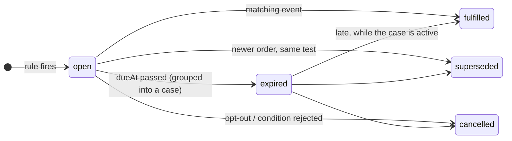
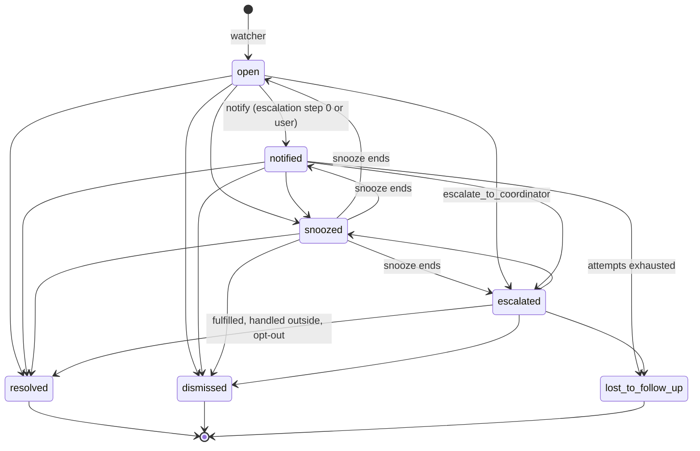

# @follow-up-engine/core

Pure domain, ports and the follow-up engine. No I/O: every effect goes through a port (`packages/core/src/ports`) implemented by an adapter (`adapter-memory`, `adapter-postgres`, `llm`). Design principle: **rules first, AI second, human last**.

```
src/
  domain/        ids, clinical events, expectations, cases, conditions, findings, domain events, errors
  config/        zod schemas of rules, protocols and escalation policies + pure JSON loaders
  ports/         repositories, UnitOfWork, JobQueue/Outbox, Clock, IdGenerator, NoteExtractor,
                 ClinicDirectory, LlmGateway, LlmUsageLog, RuleSource, ProtocolSource
  engine/
    application/ createFollowUpEngine, ingest, note extraction job, condition commands
    annotator/   the four expectation layers + condition inference + the annotation pipeline
    matching/    declarative filters, match keys, fulfillment and supersession
    watcher/     deadline sweep: expire expectations, open or merge cases
    case-manager/ case state machine, writer (audit + outbox), priority, reconciliation, commands
    escalation/  escalation sweep and scheduling
    patient-contact/ who may be contacted, and when
```

## Entry points

```ts
const engine = createFollowUpEngine({
  unitOfWork, // UnitOfWork: every write of an operation commits together (jobs and outbox included)
  noteExtractor, // NoteExtractor: reads the doctor's plan from a note (llm package, or FakeNoteExtractor)
  rules, // RuleSource: config/rules enabled for the clinic
  protocols, // ProtocolSource: config/protocols enabled for the clinic
  clinics, // ClinicDirectory: clinic settings (allowPatientContact, ...)
  clock, // Clock: SystemClock or FakeClock
  ids, // IdGenerator: UUIDs in production, a sequence in tests
  settings, // optional Partial<EngineSettings>
});
```

| Method                                                           | What it does                                                                                                                                                                                                                                                                                                                           |
| ---------------------------------------------------------------- | -------------------------------------------------------------------------------------------------------------------------------------------------------------------------------------------------------------------------------------------------------------------------------------------------------------------------------------- |
| `ingest(batch: ClinicalBatch): Promise<IngestReport>`            | "A consultation was saved". Reads the notes (outside the transaction), then in one transaction: stores the events, derives conditions, creates expectations (universal → doctor's plan → cadence), applies fulfillment and supersession, lets protocols fill the gaps, resolves satisfied cases, records quality findings. Idempotent. |
| `runWatcher(clinicId, now): Promise<WatcherReport>`              | Deadline sweep: open expectations with `dueAt <= now` become `expired` and are grouped into one active case per patient and case group (opened or merged).                                                                                                                                                                             |
| `runEscalation(clinicId, now): Promise<EscalationReport>`        | Advances every due case along its escalation policy; wakes snoozed cases. Emits `case.escalated`, `patient_contact.requested`, `case.resolved` to the outbox.                                                                                                                                                                          |
| `runNoteExtractionJob(clinicId, payload): Promise<IngestReport>` | Handler of the `note.extract_plan` job enqueued when the extractor failed during ingest. Throws to be retried.                                                                                                                                                                                                                         |
| `cases.apply(clinicId, caseId, action, actor)`                   | `notify`, `snooze`, `resolve`, `dismiss`, `assign` (also as `cases.notify`, `cases.snooze`, ...). Invalid transitions throw `InvalidCaseTransitionError` (HTTP 409).                                                                                                                                                                   |
| `cases.recordFeedback(clinicId, caseId, input)`                  | Useful / not useful; a reason is mandatory when not useful (`ValidationError`, HTTP 422).                                                                                                                                                                                                                                              |
| `conditions.confirm / reject(clinicId, patientId, code, userId)` | Clinician review of an inferred or extracted condition. Rejecting cancels the protocol expectations that relied on it.                                                                                                                                                                                                                 |
| `catalog(clinicId)`                                              | The enabled rules and protocols as `ExpectationDefinition`s (labels, suggested actions, policies).                                                                                                                                                                                                                                     |
| `patientContactStatus(clinicId, patientId)`                      | Whether the engine may contact the patient, and when it last asked.                                                                                                                                                                                                                                                                    |

## Expectation layers

| Layer         | Source                                                                                                                                        | Example rule ids                                                                                                                                                          |
| ------------- | --------------------------------------------------------------------------------------------------------------------------------------------- | ------------------------------------------------------------------------------------------------------------------------------------------------------------------------- |
| `universal`   | Structured data only, no LLM.                                                                                                                 | `lab_order_result_pending` (15 d), `imaging_order_result_pending` (30 d), `short_treatment_followup` (end of treatment + 3 d), `abnormal_result_followup` (7 d)           |
| `doctor_plan` | Plan items the `NoteExtractor` read from the note ("control en 3 meses"). The item's own date wins.                                           | `doctor_plan_followup`                                                                                                                                                    |
| `cadence`     | A break in the patient's own visit pattern: with 2+ previous visits of the same specialty, the next one is due within 3x the median interval. | `cadence_break`                                                                                                                                                           |
| `protocol`    | Per-condition guideline for enrolled patients (confirmed or probable condition).                                                              | `protocol_diabetes_visit`, `protocol_diabetes_hba1c`, `protocol_diabetes_lipids`, `protocol_diabetes_fundus`, `protocol_hypertension_visit`, `protocol_hypertension_labs` |

Precedence:

1. **The doctor's plan beats the protocol.** Protocols run last and skip any item already asked for by a live `doctor_plan` or `universal` expectation with the same match key (`visit`, `loinc:4548-4`, ...).
2. **Cadence needs a pattern**: at least 2 previous visits of the specialty (intervals under 7 days ignored).
3. **One case per patient and reason group.** Expectations whose rules share a `caseGroup` (`follow_up`, `pending_results`) merge into one case with all their reasons.
4. **A note without a plan is a quality finding** (`note_without_plan`), never a case.

Conditions: a coded diagnosis is `confirmed`; a provisional diagnosis, a diagnosis read from a note, a medication (metformin, losartan, ...) or a result (HbA1c >= 6.5) make it `probable`. A clinician's review is never overwritten by automation.

## Fulfillment and supersession

Each rule declares `fulfilledBy`, `supersededBy` and `notFulfilledBy` correlations (`same_order`, `same_code`, `same_specialty`, `any`). Except for `same_order`, a candidate event must happen after the expectation's trigger, and a finished encounter never fulfills an expectation created in that same encounter. Consequences:

- A result answers its order (`basedOn`) or any later result of the same code.
- A finished encounter or a booked appointment fulfills visit expectations, never lab or imaging ones.
- A new order of the **same** test supersedes the old expectation (its case closes as `not_needed`, audit reason `superseded_by_new_order`) and starts a new clock; different tests coexist.
- An expired expectation can still be fulfilled late while its case is active; the case resolves when all its reasons are closed.

Idempotency: an expectation's key is `<source type>/<source id>#<rule id>[#<item>]`; events are stored once per `idempotencyKey`; a note whose plan was already extracted is never read again.

## State machines





Every transition is appended to the `AuditLog` with its actor (`rule`, `user`, `patient`, `system`) in the same transaction as the change and its outbound event.

## Escalation (`default_v1`)

`config/rules/escalation/default_v1.json`, referenced by id from rules and protocols:

| After (days from opening) | Action                                                                                 |
| ------------------------- | -------------------------------------------------------------------------------------- |
| 0                         | `notify_clinic`: the owner (treating practitioner, else `front_desk`) is notified once |
| 14                        | `raise_priority` (+20) and `request_patient_contact`                                   |
| 21                        | `escalate_to_coordinator`                                                              |
| 35                        | `mark_lost_to_follow_up`                                                               |

A user action (notify, assign, end of a snooze) restarts the wait before the next step.

Patient contact rules (`patient-contact/policy.ts`): only if the clinic allows it; never after `patient.opted_out` (which also closes everything open); never for cases resting only on probable conditions; at most one request per patient per 14 days whatever the number of cases. The `patient_contact.requested` payload carries ids, a generic purpose and a date, never a diagnosis or test name.

## Adding a rule or a protocol

1. Add the JSON to `config/rules/*.json` (a rule or an array of rules) or `config/protocols/<id>.json`. Use `"escalationPolicy": "default_v1"` or inline steps. Give `reason.code` the rule id and a Spanish `label`.
2. Pick `expects` (what must happen), `caseGroup` (which case it merges into) and correlations (`fulfilledBy`, `supersededBy`, `notFulfilledBy`). Filters accept literals, lists and bounds (`{ "durationDays": { "lte": 30 } }`).
3. Validate: `loadConfigDirectory()` from `@follow-up-engine/adapter-memory` (or `loadRulesFromJson` / `loadProtocolsFromJson` here) lists every problem with its file.
4. Add a scenario in `packages/adapter-memory/src/scenarios` with the DSL:

```ts
await scenario()
  .at(0)
  .consult({ encounterId: 'enc-1', labs: [{ id: 'sr-1', code: CODES.hba1c }] })
  .advance('16d')
  .runWatcher()
  .expectCases([{ reasons: ['lab_order_result_pending'] }])
  .run();
```

Nothing is enabled for a clinic without clinical team validation: `RuleSource` and `ProtocolSource` return only what is enabled for the clinic, with per-clinic overrides (for example a 10-day lab deadline).
