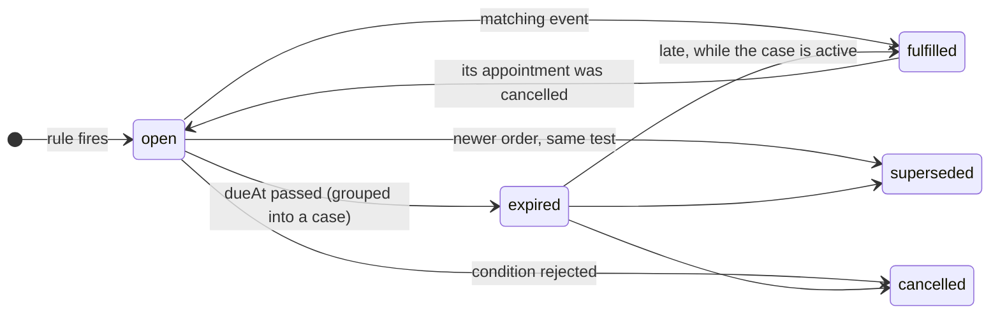
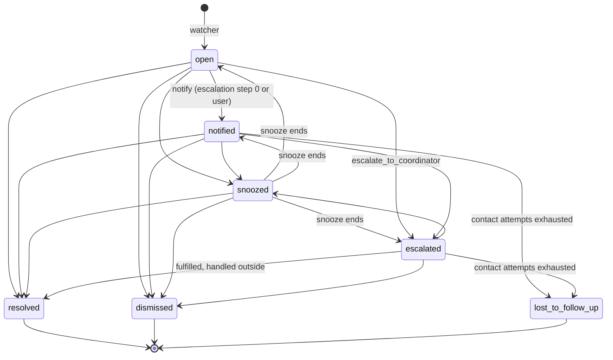

# @follow-up-engine/core

Pure domain, ports and the follow-up engine. No I/O: every effect goes through a port (`packages/core/src/ports`) implemented by an adapter (`adapter-memory`, `adapter-postgres`, `llm`). Design principle: **rules first, AI second, human last**.

```
src/
  domain/        ids, clinical events, expectations, cases, conditions, findings, domain events, errors
  config/        zod schemas of rules, protocols and escalation policies + pure JSON loaders
  ports/         repositories, UnitOfWork, JobQueue/Outbox, Clock, IdGenerator, NoteExtractor,
                 ClinicDirectory, LlmGateway, LlmUsageLog, RuleSource, ProtocolSource
  engine/
    application/ createFollowUpEngine, ingest, note extraction job, condition commands
    annotator/   the four expectation layers + condition inference + the annotation pipeline
    matching/    declarative filters, match keys, fulfillment and supersession
    watcher/     deadline sweep: expire expectations, open or merge cases
    case-manager/ case state machine, writer (audit + outbox), priority, reconciliation, commands
    escalation/  escalation sweep and scheduling
    patient-contact/ who may be contacted, and when
```

## Entry points

```ts
const engine = createFollowUpEngine({
  unitOfWork, // UnitOfWork: every write of an operation commits together (jobs and outbox included)
  noteExtractor, // NoteExtractor: reads the doctor's plan from a note (llm package, or FakeNoteExtractor)
  rules, // RuleSource: config/rules enabled for the clinic
  protocols, // ProtocolSource: config/protocols enabled for the clinic
  clinics, // ClinicDirectory: clinic settings (allowPatientContact, ...)
  clock, // Clock: SystemClock or FakeClock
  ids, // IdGenerator: UUIDs in production, a sequence in tests
  settings, // optional Partial<EngineSettings>
});
```

| Method                                                           | What it does                                                                                                                                                                                                                                                                                                                                  |
| ---------------------------------------------------------------- | --------------------------------------------------------------------------------------------------------------------------------------------------------------------------------------------------------------------------------------------------------------------------------------------------------------------------------------------- |
| `ingest(batch: ClinicalBatch): Promise<IngestReport>`            | "A consultation was saved". Reads the notes (outside the transaction), then in one transaction: stores the events, derives conditions, creates expectations (universal → doctor's plan), applies fulfillment and supersession, adds cadence and lets protocols fill the gaps, resolves satisfied cases, records quality findings. Idempotent. |
| `runWatcher(clinicId, now): Promise<WatcherReport>`              | Releases the backfill cases whose day came (`casesReleased`), then the deadline sweep: open expectations with `dueAt <= now` become `expired` and are grouped into one active case per patient and case group (opened or merged).                                                                                                             |
| `runEscalation(clinicId, now): Promise<EscalationReport>`        | Advances every due case along its escalation policy; wakes snoozed cases. Emits `case.escalated`, `patient_contact.requested`, `case.resolved` to the outbox.                                                                                                                                                                                 |
| `runNoteExtractionJob(clinicId, payload): Promise<IngestReport>` | Handler of the `note.extract_plan` job enqueued when the extractor failed during ingest. Throws to be retried.                                                                                                                                                                                                                                |
| `cases.apply(clinicId, caseId, action, actor)`                   | `notify`, `snooze`, `resolve`, `dismiss`, `assign` (also as `cases.notify`, `cases.snooze`, ...). Invalid transitions throw `InvalidCaseTransitionError` (HTTP 409).                                                                                                                                                                          |
| `cases.requestPatientContact(clinicId, caseId, actor)`           | A user asks the host to contact the patient ("Pedir contacto"): audits `patient_contact_requested`, emits `patient_contact.requested`. Throws `PatientContactNotAllowedError` (`reason`: `clinic_disallows_contact`, `patient_opted_out`, `contact_window`; HTTP 409).                                                                        |
| `cases.recordFeedback(clinicId, caseId, input)`                  | Useful / not useful; a reason is mandatory when not useful (`ValidationError`, HTTP 422).                                                                                                                                                                                                                                                     |
| `conditions.confirm / reject(clinicId, patientId, code, userId)` | Clinician review of an inferred or extracted condition. Rejecting cancels the protocol expectations that relied on it.                                                                                                                                                                                                                        |
| `catalog(clinicId)`                                              | The enabled rules and protocols as `ExpectationDefinition`s (labels, suggested actions, policies).                                                                                                                                                                                                                                            |
| `patientContactStatus(clinicId, patientId)`                      | Whether the engine may contact the patient, and when it last asked.                                                                                                                                                                                                                                                                           |
| `backfill.stage / run / status / schedule / release`             | The initial backfill of a clinic; see [Initial backfill](#initial-backfill).                                                                                                                                                                                                                                                                  |

## Expectation layers

| Layer         | Source                                                                                                                                        | Example rule ids                                                                                                                                                          |
| ------------- | --------------------------------------------------------------------------------------------------------------------------------------------- | ------------------------------------------------------------------------------------------------------------------------------------------------------------------------- |
| `universal`   | Structured data only, no LLM.                                                                                                                 | `lab_order_result_pending` (15 d), `imaging_order_result_pending` (30 d), `short_treatment_followup` (end of treatment + 3 d), `abnormal_result_followup` (7 d)           |
| `doctor_plan` | Plan items the `NoteExtractor` read from the note ("control en 3 meses"). The item's own date wins.                                           | `doctor_plan_followup`                                                                                                                                                    |
| `cadence`     | A break in the patient's own visit pattern: with 2+ previous visits of the same specialty, the next one is due within 3x the median interval. | `cadence_break`                                                                                                                                                           |
| `protocol`    | Per-condition guideline for enrolled patients (confirmed or probable condition).                                                              | `protocol_diabetes_visit`, `protocol_diabetes_hba1c`, `protocol_diabetes_lipids`, `protocol_diabetes_fundus`, `protocol_hypertension_visit`, `protocol_hypertension_labs` |

Precedence:

1. **The doctor's plan beats the protocol and the cadence.** Protocols run last and skip any item already asked for by a live `doctor_plan` or `universal` expectation with the same match key (`visit`, `loinc:4548-4`, ...); the cadence layer skips the next visit while a live `doctor_plan` visit asks for it (checked after fulfillment, so the visit that fulfills the plan brings the pattern back).
2. **Cadence needs a pattern**: at least 2 previous visits of the specialty, i.e. one interval (intervals under 7 days ignored); a single visit never makes one.
3. **One case per patient and reason group.** Expectations whose rules share a `caseGroup` (`follow_up`, `pending_results`) merge into one case with all their reasons.
4. **A note without a plan is a quality finding** (`note_without_plan`), never a case.

Conditions: a coded diagnosis is `confirmed`; a provisional diagnosis, a diagnosis read from a note, a medication (metformin, losartan, ...) or a result (HbA1c >= 6.5) make it `probable`. A clinician's review is never overwritten by automation.

## Fulfillment and supersession

Each rule declares `fulfilledBy`, `supersededBy` and `notFulfilledBy` correlations (`same_order`, `same_code`, `same_specialty`, `any`). Except for `same_order`, a candidate event must happen after the expectation's trigger, and a finished encounter never fulfills an expectation created in that same encounter. Consequences:

- A result answers its order (`basedOn`) or any later result of the same code.
- A finished encounter or a booked appointment fulfills visit expectations, never lab or imaging ones.
- **A booking counts only if it brings the visit in on time**: scheduled on or before the due date plus `toleranceDays` (on the correlation; default `DEFAULT_BOOKING_TOLERANCE_DAYS` = 3). A booking made once the expectation is overdue (the team called the patient) counts when the appointment falls within one normal window of the booking (the time the expectation originally gave). A booking for months later does not fulfill an abnormal result's 7-day follow-up; the case opens on time.
- **A visit must be with the right people.** A visit expectation (`follow_up_visit`, `session`) is fulfilled only by a visit of its specialty (the protocol's `specialties`, else the specialty of the consultation that created it) or with the same practitioner; a gynecology visit does not fulfill the diabetologist's control, nor re-anchors the diabetes protocol. When either side has no specialty recorded, any visit counts (hosts without specialties keep working). A correlation with its own `specialty` filter (fundus exam at ophthalmology) is not restricted further.
- A new order of the **same** test supersedes the old expectation (its case closes as `not_needed`, audit reason `superseded_by_new_order`) and starts a new clock; different tests coexist.
- An expired expectation can still be fulfilled late while its case is active; the case resolves when all its reasons are closed.
- **A cancelled appointment fulfills nothing.** Every closed expectation records what closed it (`closedBy`). An `appointment.cancelled` (a cancellation, a no-show, or an appointment entered in error: `reason`) reopens what that Appointment's booking fulfilled, unless something else in the record (a visit, another booking) still fulfills it; a reopened expectation already past due expires into a case at the next watcher run (a new case if the booking had resolved the old one). Bookings withdrawn by a later cancellation are ignored everywhere else too (protocol anchors, fulfillment), and an expectation anchored on the withdrawn booking (the protocol's next visit counted from it) is cancelled with `closedReason: 'source_withdrawn'`.

**Updates to resources already sent** (HIP-116):

- A `record.withdrawn` event (an order revoked, a prescription stopped or cancelled, a diagnosis refuted, a note or result entered in error, a note superseded) cancels the live expectations the resource triggered (`closedReason: 'source_withdrawn'`; a case left without open reasons resolves as `not_needed`) and reopens what it fulfilled, like a cancelled booking. The timeline ignores the resource's earlier events (and what was derived from them: a withdrawn note's plan), so they neither trigger, fulfill nor anchor anything again.
- When the withdrawal means the fact was never true (`refuted`, `entered_in_error`, `subject_changed`), a condition that the resource alone recorded becomes `resolved` (unless a clinician reviewed it) and the protocol expectations of protocols the patient is no longer enrolled in are cancelled (`source_withdrawn`).
- A resource re-sent for another patient (its `subject` corrected): `ingest` finds the other patients with events of the same source (`ClinicalRecordRepository.findOtherPatientsWithSources`), records a `record.withdrawn` (`subject_changed`) for each and annotates it there, so the old patient's expectation is cancelled; the new patient gets its own expectation (key `<key>@<patientId>` when the plain key is taken).
- An amended note (a new version of the same document, or one that `replaces` it) is read again (extraction is deduplicated by note version, and skipped when the text did not change); live plan items of the earlier version that the new plan does not ask for again are superseded (`superseded_by_amended_note`).
- Out-of-order delivery: adapters do not store an older version than the stored one (`isOlderResourceVersion`: numeric `meta.versionId`, else `meta.lastUpdated`), `saveResource` answers `stale: true`, and the runtime does not ingest its events.

Idempotency: an expectation's key is `<source type>/<source id>#<rule id>[#<item>]`; events are stored once per `idempotencyKey`; a note whose plan was already extracted is never read again.

## State machines





Every transition is appended to the `AuditLog` with its actor (`rule`, `user`, `patient`, `system`) in the same transaction as the change and its outbound event.

**Concurrent writers are serialized per case** (HIP-119). Every read-modify-write of a case locks it until its transaction commits (`CaseRepository.get(..., { forUpdate: true })`, `findActiveByDedupKey(..., { forUpdate: true })`: Postgres `SELECT ... FOR UPDATE`; the memory adapter serializes whole transactions). A second command on the same case waits, then sees the first one's outcome and fails exactly as it would afterwards (`InvalidCaseTransitionError`, HTTP 409), with no audit entry and no `case.resolved` of its own. The escalation sweep locks the due cases it takes and skips one a user is changing right now (`FOR UPDATE SKIP LOCKED`), so a user's dismiss is never overwritten by a stale escalation step. The priority refresh writes only the priority of a still active case (`setPriority`).

## Escalation (`default_v1`)

`config/rules/escalation/default_v1.json`, referenced by id from rules and protocols:

| After (days from opening) | Action                                                                                 |
| ------------------------- | -------------------------------------------------------------------------------------- |
| 0                         | `notify_clinic`: the owner (treating practitioner, else `front_desk`) is notified once |
| 14                        | `raise_priority` (+20) and `request_patient_contact`                                   |
| 21                        | `escalate_to_coordinator`                                                              |
| 35                        | `mark_lost_to_follow_up`, only if the patient was asked to come back (see below)       |

A user action (notify, assign, end of a snooze) restarts the wait before the next step.

**Lost to follow-up means attempts were made and exhausted.** `mark_lost_to_follow_up` closes the case only when a contact request went out for the patient since the case opened (the automatic step or a user's "Pedir contacto", from any of the patient's cases). The resolution is `patient_unreachable`, or `patient_declined` when the patient opted out after being contacted. When nobody contacted the patient (the clinic does not allow it, the patient opted out first, the case rests on probable conditions, the case comes from the backfill), the step is skipped (`EscalationReport.lostToFollowUpSkipped`) and the case stays escalated with the coordinator until someone resolves or dismisses it.

Patient contact rules (`patient-contact/policy.ts`): only if the clinic allows it; never after `patient.opted_out`; never for cases resting only on probable conditions; at most one request per patient per 14 days whatever the number of cases.

**Opt-out means no patient contact, not no follow-up.** After `patient.opted_out` the clinic keeps following the patient: expectations and cases are created, merged and resolved as usual, and `patientContactStatus` reports `optedOut: true` (`allowed: false`). Escalation skips the patient-contact step and goes straight to the coordinator instead of waiting for an answer that cannot come. The `patient_contact.requested` payload carries ids, a generic purpose and a date, never a diagnosis or test name.

## Case priority

`computeCasePriority` (`case-manager/priority.ts`, `PRIORITY_MODEL`), 0 to 100; the inbox and the FHIR Task read ≥ 90 as urgent, ≥ 75 high, ≥ 60 medium. **Recomputed on every watcher tick** (`refreshCasePriorities`, `WatcherReport.prioritiesUpdated`; it writes only the priority, through `CaseRepository.setPriority`), so the overdue factor follows the calendar for live and backfill cases alike.

| Part                 | Points                                                                                                                                   |
| -------------------- | ---------------------------------------------------------------------------------------------------------------------------------------- |
| Category of a reason | abnormal result 75 > ordered result (lab, imaging) 60 > doctor's plan and end of treatment 50 > cadence 38 > protocol 32                 |
| Rule `priority`      | (priority − 40) / 4, at most ±5: a nudge within the category                                                                             |
| Confidence           | protocol reminder resting only on a probable condition −10; any other reason of a patient with a confirmed chronic condition +3          |
| Overdue factor       | +0.5 per day overdue up to +6 (day 12), flat to day 90, then −1 every 15 days down to −20 (a control missed in 2024 ranks below today's) |
| Case                 | its most pressing reason (still open or expired), +3 per extra reason (at most 2), + the `raise_priority` steps already run (+20)        |

A fresh ordered result is medium (61), a fresh abnormal result high (80); only an abnormal result left without action until its escalation becomes urgent; a probable-only protocol reminder stays low. On the synthetic clinic at day 0: 6 urgent, 15 high, 15 medium, 68 low of 104 released cases (it was 50 urgent, 29 high, 23 medium, 1 low).

## Initial backfill

On the day the engine is turned on for a clinic, its history is replayed as if every document had just arrived (PRD "Initial backfill", HIP-110). Without it, everything before activation would stay invisible.

```ts
// 1. Import the history: FHIR bundles -> mapBundleToBatches -> stage (stored, not annotated).
for (const batch of mapBundleToBatches(bundle, { clinicId, receivedAt }).batches) {
  await engine.backfill.stage(batch); // idempotent on event keys
}
// 2. Replay (a job of the worker; call again to resume a crashed or budget-paused run).
const report = await engine.backfill.run(clinicId, { shadow: false });
// report.progress: BackfillProgress (status, counters, cursor); report.release: BackfillReleasePlan
```

| Method                                                                            | What it does                                                                                                                                                             |
| --------------------------------------------------------------------------------- | ------------------------------------------------------------------------------------------------------------------------------------------------------------------------ |
| `backfill.stage(batch: ClinicalBatch): Promise<{ inserted }>`                     | Stores historical events without annotating them. Idempotent.                                                                                                            |
| `backfill.run(clinicId, { runId?, shadow?, pageSize? }): Promise<BackfillReport>` | Starts a run, or resumes the clinic's unfinished one (`resumed: true`). Returns when it completes (`status: 'completed'`, with `release`) or pauses (`'paused_budget'`). |
| `backfill.status(clinicId, runId?): Promise<BackfillProgress \| undefined>`       | A run by id, else the unfinished run (`running` or `paused_budget`).                                                                                                     |
| `backfill.schedule(clinicId, now): Promise<BackfillReleasePlan>`                  | Gives every still-unscheduled backfill case a release day. How a shadow run goes live. Idempotent.                                                                       |
| `backfill.release(clinicId, now): Promise<CaseId[]>`                              | Activates the cases whose release day came (also done by every `runWatcher`).                                                                                            |

How it works:

- **Same path as steady state.** Each patient's stored events are grouped into steps (one per consultation, else per instant) and annotated in order through `ingest`'s own `extractNotes` and `applyInTransaction`, with `now` = the step's time and the patient's state as of that time. Notes not read yet go through the `NoteExtractor` (`llm_gateway`).
- **History closes itself.** What a later event fulfilled (a result for an order, a visit for a plan) closes without a case; a newer order of the same test supersedes; a cancelled booking fulfills nothing. Only what is still unmet when the replay reaches today becomes a case, with `origin: 'backfill'`.
- **Held, then released in batches.** A backfill case is created with `releaseAt = BACKFILL_UNSCHEDULED_RELEASE_AT` (year 9999: hidden by every `releasedAsOf` query, no escalation). When the run completes, `schedule` orders cases by risk (priority, see [Case priority](#case-priority); then the longest overdue) and gives each owner at most `ClinicSettings.dailyCaseCapPerOwner` (default 20) per day, day 0 being now. Cases whose most recent reason is overdue by more than `backfillNotifyMaxAgeDays` (default 730) are never released: they stay listed among the patients to recover. `runWatcher` releases each day's batch: `released` audit event, escalation starts, `case.opened` emitted. If something due today joins a held case, it is released at once.
- **No mass messages.** Backfill cases never request patient contact (`PatientContactDenial` `backfill_case`); the team decides.
- **Resumable and idempotent.** One transaction per patient carries its writes and `BackfillProgressStore.advance`; a crash rolls the patient back and `run` continues after the last finished patient, with the same totals. Running again replays everything and changes nothing (keys by source and rule; decisions taken on the state as of each step).
- **Budget.** `LlmBudgetExceededError` from the extractor pauses the run at the last finished patient (`paused_budget`) and emits `backfill.paused`; `run` resumes it once there is budget.
- **Shadow mode** (`{ shadow: true }`) computes and stores everything and schedules nothing; `schedule` makes it live.
- `backfill.completed` carries `BackfillCounts` (patients, events, documents, expectations created and fulfilled, cases opened, LLM cost) plus `casesScheduled` and `casesNotNotified`, measured from what was stored.

For the inbox: active cases are `list({ statuses: ACTIVE, releasedAsOf: now })`; the patients to recover are `list({ origin: 'backfill', unreleasedAsOf: now })`.

On the synthetic clinic (120 patients, two years, 1,680 bundles; acceptance test `packages/acceptance/test/backfill.test.ts`): 5,074 events and 671 notes replayed, 2,207 expectations created and 1,793 of them fulfilled by the history itself, 92 cases for 74 patients (at most 2 per patient), released 91 on day 0 and 1 on day 1 under the default cap.

## Adding a rule or a protocol

1. Add the JSON to `config/rules/*.json` (a rule or an array of rules) or `config/protocols/<id>.json`. Use `"escalationPolicy": "default_v1"` or inline steps. Give `reason.code` the rule id and a Spanish `label`.
2. Pick `expects` (what must happen), `caseGroup` (which case it merges into) and correlations (`fulfilledBy`, `supersededBy`, `notFulfilledBy`). Filters accept literals, lists and bounds (`{ "durationDays": { "lte": 30 } }`).
3. Validate: `loadConfigDirectory()` from `@follow-up-engine/adapter-memory` (or `loadRulesFromJson` / `loadProtocolsFromJson` here) lists every problem with its file.
4. Add a scenario in `packages/adapter-memory/src/scenarios` with the DSL:

```ts
await scenario()
  .at(0)
  .consult({ encounterId: 'enc-1', labs: [{ id: 'sr-1', code: CODES.hba1c }] })
  .advance('16d')
  .runWatcher()
  .expectCases([{ reasons: ['lab_order_result_pending'] }])
  .run();
```

Nothing is enabled for a clinic without clinical team validation: `RuleSource` and `ProtocolSource` return only what is enabled for the clinic, with per-clinic overrides (for example a 10-day lab deadline).
