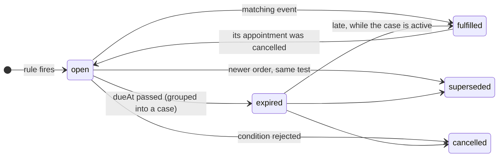
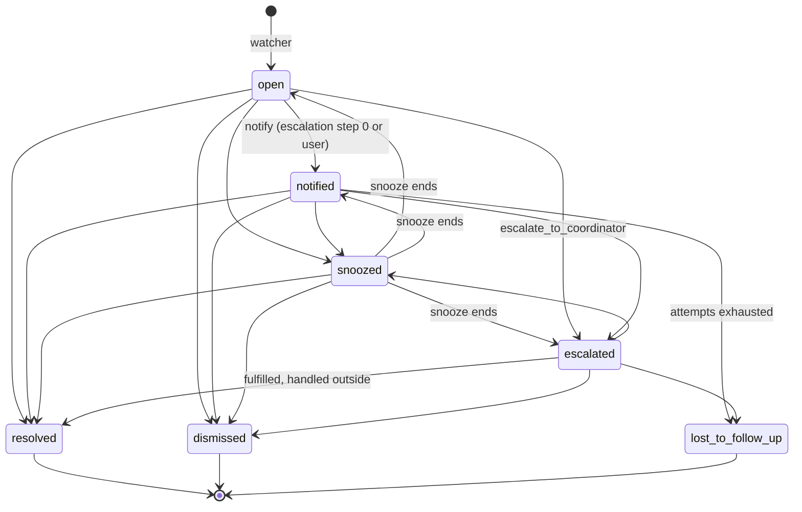

# @follow-up-engine/core

Pure domain, ports and the follow-up engine. No I/O: every effect goes through a port (`packages/core/src/ports`) implemented by an adapter (`adapter-memory`, `adapter-postgres`, `llm`). Design principle: **rules first, AI second, human last**.

```
src/
  domain/        ids, clinical events, expectations, cases, conditions, findings, domain events, errors
  config/        zod schemas of rules, protocols and escalation policies + pure JSON loaders
  ports/         repositories, UnitOfWork, JobQueue/Outbox, Clock, IdGenerator, NoteExtractor,
                 ClinicDirectory, LlmGateway, LlmUsageLog, RuleSource, ProtocolSource
  engine/
    application/ createFollowUpEngine, ingest, note extraction job, condition commands
    annotator/   the four expectation layers + condition inference + the annotation pipeline
    matching/    declarative filters, match keys, fulfillment and supersession
    watcher/     deadline sweep: expire expectations, open or merge cases
    case-manager/ case state machine, writer (audit + outbox), priority, reconciliation, commands
    escalation/  escalation sweep and scheduling
    patient-contact/ who may be contacted, and when
```

## Entry points

```ts
const engine = createFollowUpEngine({
  unitOfWork, // UnitOfWork: every write of an operation commits together (jobs and outbox included)
  noteExtractor, // NoteExtractor: reads the doctor's plan from a note (llm package, or FakeNoteExtractor)
  rules, // RuleSource: config/rules enabled for the clinic
  protocols, // ProtocolSource: config/protocols enabled for the clinic
  clinics, // ClinicDirectory: clinic settings (allowPatientContact, ...)
  clock, // Clock: SystemClock or FakeClock
  ids, // IdGenerator: UUIDs in production, a sequence in tests
  settings, // optional Partial<EngineSettings>
});
```

| Method                                                           | What it does                                                                                                                                                                                                                                                                                                                                  |
| ---------------------------------------------------------------- | --------------------------------------------------------------------------------------------------------------------------------------------------------------------------------------------------------------------------------------------------------------------------------------------------------------------------------------------- |
| `ingest(batch: ClinicalBatch): Promise<IngestReport>`            | "A consultation was saved". Reads the notes (outside the transaction), then in one transaction: stores the events, derives conditions, creates expectations (universal → doctor's plan), applies fulfillment and supersession, adds cadence and lets protocols fill the gaps, resolves satisfied cases, records quality findings. Idempotent. |
| `runWatcher(clinicId, now): Promise<WatcherReport>`              | Releases the backfill cases whose day came (`casesReleased`), then the deadline sweep: open expectations with `dueAt <= now` become `expired` and are grouped into one active case per patient and case group (opened or merged).                                                                                                             |
| `runEscalation(clinicId, now): Promise<EscalationReport>`        | Advances every due case along its escalation policy; wakes snoozed cases. Emits `case.escalated`, `patient_contact.requested`, `case.resolved` to the outbox.                                                                                                                                                                                 |
| `runNoteExtractionJob(clinicId, payload): Promise<IngestReport>` | Handler of the `note.extract_plan` job enqueued when the extractor failed during ingest. Throws to be retried.                                                                                                                                                                                                                                |
| `cases.apply(clinicId, caseId, action, actor)`                   | `notify`, `snooze`, `resolve`, `dismiss`, `assign` (also as `cases.notify`, `cases.snooze`, ...). Invalid transitions throw `InvalidCaseTransitionError` (HTTP 409).                                                                                                                                                                          |
| `cases.requestPatientContact(clinicId, caseId, actor)`           | A user asks the host to contact the patient ("Pedir contacto"): audits `patient_contact_requested`, emits `patient_contact.requested`. Throws `PatientContactNotAllowedError` (`reason`: `clinic_disallows_contact`, `patient_opted_out`, `contact_window`; HTTP 409).                                                                        |
| `cases.recordFeedback(clinicId, caseId, input)`                  | Useful / not useful; a reason is mandatory when not useful (`ValidationError`, HTTP 422).                                                                                                                                                                                                                                                     |
| `conditions.confirm / reject(clinicId, patientId, code, userId)` | Clinician review of an inferred or extracted condition. Rejecting cancels the protocol expectations that relied on it.                                                                                                                                                                                                                        |
| `catalog(clinicId)`                                              | The enabled rules and protocols as `ExpectationDefinition`s (labels, suggested actions, policies).                                                                                                                                                                                                                                            |
| `patientContactStatus(clinicId, patientId)`                      | Whether the engine may contact the patient, and when it last asked.                                                                                                                                                                                                                                                                           |
| `backfill.stage / run / status / schedule / release`             | The initial backfill of a clinic; see [Initial backfill](#initial-backfill).                                                                                                                                                                                                                                                                  |

## Expectation layers

| Layer         | Source                                                                                                                                        | Example rule ids                                                                                                                                                          |
| ------------- | --------------------------------------------------------------------------------------------------------------------------------------------- | ------------------------------------------------------------------------------------------------------------------------------------------------------------------------- |
| `universal`   | Structured data only, no LLM; clinical criteria in config (short treatment, result targets).                                                  | `lab_order_result_pending` (15 d), `imaging_order_result_pending` (30 d), `short_treatment_followup` (end of treatment + 3 d), `abnormal_result_followup` (7 d)           |
| `doctor_plan` | Plan items the `NoteExtractor` read from the note ("control en 3 meses"). The item's own date wins.                                           | `doctor_plan_followup`                                                                                                                                                    |
| `cadence`     | A break in the patient's own visit pattern: with 2+ previous visits of the same specialty, the next one is due within 3x the median interval. | `cadence_break`                                                                                                                                                           |
| `protocol`    | Per-condition guideline for enrolled patients (confirmed or probable condition).                                                              | `protocol_diabetes_visit`, `protocol_diabetes_hba1c`, `protocol_diabetes_lipids`, `protocol_diabetes_fundus`, `protocol_hypertension_visit`, `protocol_hypertension_labs` |

Precedence:

1. **The doctor's plan beats the protocol and the cadence.** Protocols run last and skip any item already asked for by a live `doctor_plan` or `universal` expectation with the same match key (`visit`, `loinc:4548-4`, ...), a code of the item's equivalence group (the codes its `fulfilledBy` filters accept: any lipid panel LOINC) or, for an uncoded plan item, a quote that names the test (`planTerms`: "control en 3 meses con HbA1c"). An order or plan item that arrives later withdraws a live protocol expectation the same way (`cancelled`, `covered_by_later_request`). The cadence layer skips the next visit while a live `doctor_plan` visit or session asks for it (checked after fulfillment, so the visit that fulfills the plan brings the pattern back).
2. **The doctor's plan also beats a generic universal control** (`coveredByPlan`): a short-treatment or abnormal-result control is not added when a plan visit is already due by then ("control en 10 días" after a 7-day antibiotic is one reason, not two).
3. **Cadence needs a pattern**: at least 2 previous visits of the specialty, i.e. one interval (intervals under 7 days ignored); a single visit never makes one. **Closed episodes are not a pattern**: everything up to a discharge ("se da de alta"), a pregnancy once its postpartum visit came (`episodes`: diagnoses `O`, `Z33`-`Z36`, closed by `Z39`), an acute episode and its control (a visit that started a short course and the next visit within the course + 14 days). A discharge read later (separate note, retried extraction) withdraws the cadence expectation it anchored (`patient_discharged`).
4. **One case per patient and reason group.** Expectations whose rules share a `caseGroup` (`follow_up`, `pending_results`) merge into one case with all their reasons.
5. **A note without a plan is a quality finding** (`note_without_plan`), never a case.

Clinical criteria of the universal rules (config, see `config/rules/README.md`):

- **Short treatment** (`treatment`): 30 days or less, no refills, not a chronic drug class (ATC prefixes and drug names: statins, antidiabetics, antihypertensives, thyroid, antidepressants, contraceptives, ...), not taken only when needed (`PRN`, `SOS`, FHIR `asNeeded`), and the note does not make the return conditional ("reconsultar si persiste"). One control per consultation, when its longest treatment ends.
- **Abnormal result** (`resultTargets`): a result at the target of a condition the patient was already known to have is not abnormal, whatever the lab flag: HbA1c 4–8 % in a known diabetic. A first high HbA1c (diabetes inferred from that very result) still is.

Conditions: a coded diagnosis is `confirmed`; a provisional diagnosis, a diagnosis read from a note, a medication (metformin, losartan, ...) or a result (HbA1c >= 6.5) make it `probable`. A clinician's review is never overwritten by automation.

## Fulfillment and supersession

Each rule declares `fulfilledBy`, `supersededBy` and `notFulfilledBy` correlations (`same_order`, `same_code`, `same_specialty`, `any`). Except for `same_order`, a candidate event must happen after the expectation's trigger, and a finished encounter never fulfills an expectation created in that same encounter. Consequences:

- A result answers its order (`basedOn`) or any later result of the same code.
- A finished encounter or a booked appointment fulfills visit expectations, never lab or imaging ones.
- A new order of the **same** test supersedes the old expectation (its case closes as `not_needed`, audit reason `superseded_by_new_order`) and starts a new clock; different tests coexist.
- An expired expectation can still be fulfilled late while its case is active; the case resolves when all its reasons are closed.
- **A cancelled appointment fulfills nothing.** Every closed expectation records what closed it (`closedBy`). An `appointment.cancelled` reopens what that Appointment's booking fulfilled, unless something else in the record (a visit, another booking) still fulfills it; a reopened expectation already past due expires into a case at the next watcher run (a new case if the booking had resolved the old one). Bookings withdrawn by a later cancellation are ignored everywhere else too (protocol anchors, fulfillment).

Idempotency: an expectation's key is `<source type>/<source id>#<rule id>[#<item>]`; events are stored once per `idempotencyKey`; a note whose plan was already extracted is never read again.

## State machines





Every transition is appended to the `AuditLog` with its actor (`rule`, `user`, `patient`, `system`) in the same transaction as the change and its outbound event.

## Escalation (`default_v1`)

`config/rules/escalation/default_v1.json`, referenced by id from rules and protocols:

| After (days from opening) | Action                                                                                 |
| ------------------------- | -------------------------------------------------------------------------------------- |
| 0                         | `notify_clinic`: the owner (treating practitioner, else `front_desk`) is notified once |
| 14                        | `raise_priority` (+20) and `request_patient_contact`                                   |
| 21                        | `escalate_to_coordinator`                                                              |
| 35                        | `mark_lost_to_follow_up`                                                               |

A user action (notify, assign, end of a snooze) restarts the wait before the next step.

Patient contact rules (`patient-contact/policy.ts`): only if the clinic allows it; never after `patient.opted_out`; never for cases resting only on probable conditions; at most one request per patient per 14 days whatever the number of cases.

**Opt-out means no patient contact, not no follow-up.** After `patient.opted_out` the clinic keeps following the patient: expectations and cases are created, merged and resolved as usual, and `patientContactStatus` reports `optedOut: true` (`allowed: false`). Escalation skips the patient-contact step and goes straight to the coordinator instead of waiting for an answer that cannot come. The `patient_contact.requested` payload carries ids, a generic purpose and a date, never a diagnosis or test name.

## Initial backfill

On the day the engine is turned on for a clinic, its history is replayed as if every document had just arrived (PRD "Initial backfill", HIP-110). Without it, everything before activation would stay invisible.

```ts
// 1. Import the history: FHIR bundles -> mapBundleToBatches -> stage (stored, not annotated).
for (const batch of mapBundleToBatches(bundle, { clinicId, receivedAt }).batches) {
  await engine.backfill.stage(batch); // idempotent on event keys
}
// 2. Replay (a job of the worker; call again to resume a crashed or budget-paused run).
const report = await engine.backfill.run(clinicId, { shadow: false });
// report.progress: BackfillProgress (status, counters, cursor); report.release: BackfillReleasePlan
```

| Method                                                                            | What it does                                                                                                                                                             |
| --------------------------------------------------------------------------------- | ------------------------------------------------------------------------------------------------------------------------------------------------------------------------ |
| `backfill.stage(batch: ClinicalBatch): Promise<{ inserted }>`                     | Stores historical events without annotating them. Idempotent.                                                                                                            |
| `backfill.run(clinicId, { runId?, shadow?, pageSize? }): Promise<BackfillReport>` | Starts a run, or resumes the clinic's unfinished one (`resumed: true`). Returns when it completes (`status: 'completed'`, with `release`) or pauses (`'paused_budget'`). |
| `backfill.status(clinicId, runId?): Promise<BackfillProgress \| undefined>`       | A run by id, else the unfinished run (`running` or `paused_budget`).                                                                                                     |
| `backfill.schedule(clinicId, now): Promise<BackfillReleasePlan>`                  | Gives every still-unscheduled backfill case a release day. How a shadow run goes live. Idempotent.                                                                       |
| `backfill.release(clinicId, now): Promise<CaseId[]>`                              | Activates the cases whose release day came (also done by every `runWatcher`).                                                                                            |

How it works:

- **Same path as steady state.** Each patient's stored events are grouped into steps (one per consultation, else per instant) and annotated in order through `ingest`'s own `extractNotes` and `applyInTransaction`, with `now` = the step's time and the patient's state as of that time. Notes not read yet go through the `NoteExtractor` (`llm_gateway`).
- **History closes itself.** What a later event fulfilled (a result for an order, a visit for a plan) closes without a case; a newer order of the same test supersedes; a cancelled booking fulfills nothing. Only what is still unmet when the replay reaches today becomes a case, with `origin: 'backfill'`.
- **Held, then released in batches.** A backfill case is created with `releaseAt = BACKFILL_UNSCHEDULED_RELEASE_AT` (year 9999: hidden by every `releasedAsOf` query, no escalation). When the run completes, `schedule` orders cases by risk (priority, which weighs chronic conditions, pending results and the rule; then the longest overdue) and gives each owner at most `ClinicSettings.dailyCaseCapPerOwner` (default 20) per day, day 0 being now. Cases whose most recent reason is overdue by more than `backfillNotifyMaxAgeDays` (default 730) are never released: they stay listed among the patients to recover. `runWatcher` releases each day's batch: `released` audit event, escalation starts, `case.opened` emitted. If something due today joins a held case, it is released at once.
- **No mass messages.** Backfill cases never request patient contact (`PatientContactDenial` `backfill_case`); the team decides.
- **Resumable and idempotent.** One transaction per patient carries its writes and `BackfillProgressStore.advance`; a crash rolls the patient back and `run` continues after the last finished patient, with the same totals. Running again replays everything and changes nothing (keys by source and rule; decisions taken on the state as of each step).
- **Budget.** `LlmBudgetExceededError` from the extractor pauses the run at the last finished patient (`paused_budget`) and emits `backfill.paused`; `run` resumes it once there is budget.
- **Shadow mode** (`{ shadow: true }`) computes and stores everything and schedules nothing; `schedule` makes it live.
- `backfill.completed` carries `BackfillCounts` (patients, events, documents, expectations created and fulfilled, cases opened, LLM cost) plus `casesScheduled` and `casesNotNotified`, measured from what was stored.

For the inbox: active cases are `list({ statuses: ACTIVE, releasedAsOf: now })`; the patients to recover are `list({ origin: 'backfill', unreleasedAsOf: now })`.

On the synthetic clinic (120 patients, two years, 1,680 bundles; acceptance test `packages/acceptance/test/backfill.test.ts`): 5,074 events and 671 notes replayed, 1,884 expectations created and 1,337 of them fulfilled by the history itself, 76 cases for 69 patients (at most 2 per patient), all released on day 0: no owner has more than the default cap of 20 (`packages/acceptance/test/backfill-release-cap.test.ts`).

## Adding a rule or a protocol

1. Add the JSON to `config/rules/*.json` (a rule or an array of rules) or `config/protocols/<id>.json`. Use `"escalationPolicy": "default_v1"` or inline steps. Give `reason.code` the rule id and a Spanish `label`.
2. Pick `expects` (what must happen), `caseGroup` (which case it merges into) and correlations (`fulfilledBy`, `supersededBy`, `notFulfilledBy`). Filters accept literals, lists and bounds (`{ "durationDays": { "lte": 30 } }`).
3. Validate: `loadConfigDirectory()` from `@follow-up-engine/adapter-memory` (or `loadRulesFromJson` / `loadProtocolsFromJson` here) lists every problem with its file.
4. Add a scenario in `packages/adapter-memory/src/scenarios` with the DSL:

```ts
await scenario()
  .at(0)
  .consult({ encounterId: 'enc-1', labs: [{ id: 'sr-1', code: CODES.hba1c }] })
  .advance('16d')
  .runWatcher()
  .expectCases([{ reasons: ['lab_order_result_pending'] }])
  .run();
```

Nothing is enabled for a clinic without clinical team validation: `RuleSource` and `ProtocolSource` return only what is enabled for the clinic, with per-clinic overrides (for example a 10-day lab deadline).
